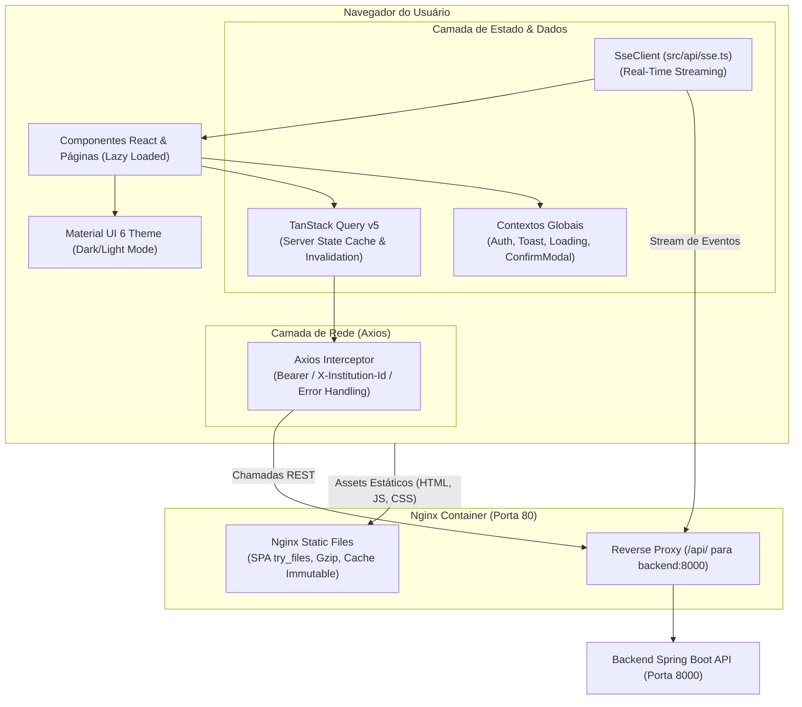

# 🎨 Sistema de Gestão de Bibliotecas Escolares (Frontend SPA)

[](https://react.dev/)
[](https://www.typescriptlang.org/)
[](https://vitejs.dev/)
[](https://mui.com/)
[](https://tanstack.com/query/latest)
[](https://www.docker.com/)
[](https://nginx.org/)

> **Interface do Usuário (SPA):** Aplicação web moderna, responsiva e acessível para controle de acervo bibliográfico, circulação de exemplares, gestão de leitores e monitoramento em tempo real das bibliotecas da Rede de Ensino Profissional (Rede E.E.E.P.).

⚙️ **Repositório do Backend API:** [sboot-api-biblioteca](https://github.com/fabriciosouza0/sboot-api-biblioteca) (Java 25, Spring Boot 3.5, PostgreSQL 16 com RLS, RabbitMQ, Docker).

---

## 🏛️ Visão Geral da Arquitetura do Frontend

O projeto foi arquitetado priorizando separação clara de responsabilidades, performance de renderização, gerenciamento previsível de estado assíncrono e experiência do usuário (UX) refinada:



---

## 💎 Destaques de Engenharia & Boas Práticas

### 1. Gerenciamento de Estado de Servidor com TanStack Query v5

Para eliminar problemas clássicos de sincronização de estado manual (`useEffect` acumulados, variáveis booleanas de loading espalhadas e *race conditions*):

- **Cache Inteligente e Deduplicação:** As requisições de listagem de livros, exemplares e usuários são cacheadas com chaves estruturadas (`['works']`, `['loans', institutionId]`), evitando requisições duplicadas.
- **Refetching em Background:** Dados são atualizados automaticamente em segundo plano ao refocar a aba da aplicação ou reconectar a rede.
- **Invalidação Cirúrgica de Queries:** Após mutações (ex.: devolução de livro ou cadastro de novo leitor), o cliente TanStack Query invalida exatamente as chaves afetadas, atualizando a visualização de forma instantânea sem recarregar a página inteira:
  ```typescript
  const queryClient = useQueryClient();
  const mutation = useMutation({
    mutationFn: returnBookLoan,
    onSuccess: () => {
      queryClient.invalidateQueries({ queryKey: ['loans'] });
      queryClient.invalidateQueries({ queryKey: ['dashboard'] });
    }
  });
  ```

---

### 2. Streaming em Tempo Real com Server-Sent Events (`src/api/sse.ts`)

O painel de controle (Dashboard) consome dados ao vivo emitidos pelo backend sem a sobrecarga do WebSocket nem o custo de requisições contínuas de polling:

- **Classe `SseClient` Nativa e Resiliente:** Construída sobre a Fetch API com suporte a `AbortController`, parser linha a linha de blocos `event:` e `data:`.
- **Reconexão com Backoff Exponencial:** Caso a conexão caia temporariamente, o cliente reconecta automaticamente aumentando o tempo de espera gradualmente até o teto de 30 segundos (`MAX_RETRY_MS = 30_000`).
- **Desconexão Limpa:** Ao desmontar os componentes de dashboard, o `AbortController` cancela a stream imediatamente para evitar vazamento de memória e conexões zumbis no servidor.

---

### 3. Design System Minimalista com Material UI 6 (MUI)

- **Tema Tipográfico e Cores Customizadas (`src/theme.ts`):** Interface profissional, clean e ergonômica desenvolvida com base no Material Design 3.
- **Dark Mode / Light Mode:** Alternância nativa de temas claro e escuro persistida nas preferências do usuário.
- **Drawer Expansível e Adaptativo:** Menu lateral com modo recolhido (ícones) e expandido, otimizado para telas desktop e tablets escolares.
- **Modais e Diálogos Assíncronos:** Sistema global de confirmação via `ConfirmModalContext`, permitindo invocar confirmações de exclusão e ações sensíveis diretamente através de `await confirm({ title, message })`.

---

### 4. Contextos Globais & Experiência do Usuário (UX)

- **`ToastContext`:** Sistema centralizado de notificações toast não-bloqueantes. Captura respostas de erro padronizadas do Spring Boot (`ApiError`) e exibe feedbacks amigáveis com tradução e detalhes dos campos com erro.
- **`LoadingContext`:** Backdrop semitransparente para operações pesadas que exigem bloqueio de interface.
- **`AuthContext`:**
  - Armazena o estado autenticado do usuário em memória.
  - O Refresh Token reside em cookie `httpOnly` seguro do navegador, blindado contra ataques XSS.
  - Injeta o cabeçalho `X-Institution-Id` nas requisições HTTP para garantir a integridade do isolamento multi-tenant.

---

### 5. Performance, Code Splitting e Máscaras de Entrada

- **Lazy Loading (`React.lazy` + `Suspense`):** Cada rota principal da aplicação (Catálogo, Circulação, Leitores, Configurações) é empacotada em um chunk JavaScript independente, carregado sob demanda apenas quando o usuário navega até ela.
- **Formulários e Máscaras:** Uso de máscaras dinâmicas (`react-input-mask`) para formatação estrita de ISBN-13, CPF, telefones e registros de estudantes.

---

### 6. Containerização Multi-Stage & Nginx Reverse Proxy

A imagem Docker oficial de produção utiliza uma abordagem multi-stage para gerar uma imagem final leve (~25MB) e segura:

1. **Stage 1 (`build`):** Ambiente Node 20 Alpine que instala dependências (`npm ci`) e compila o bundle com TypeScript e Vite (`npm run build`).
2. **Stage 2 (`runtime`):** Servidor Nginx Alpine enxuto:
   - **Roteamento SPA:** `try_files $uri $uri/ /index.html` garantindo que o React Router controle as URLs sem erros 404 ao recarregar a página.
   - **Proxy Reverso Integrado:** O bloco `location /api/` repassa o tráfego diretamente para `http://backend:8000`, eliminando qualquer problema de Cross-Origin Resource Sharing (CORS) em ambientes conteinerizados.
   - **Performance HTTP:** Compressão **Gzip** ativada para HTML/CSS/JS e cabeçalhos imutáveis de cache (`Cache-Control: public, immutable`) com expiração de 1 ano para assets estáticos que possuem hashes gerados pelo Vite.

---

## 🚀 Como Executar o Frontend Localmente

### Pré-requisitos
- **Node.js:** Versão 20 ou superior
- **npm:** Versão 10 ou superior
- Backend em execução (veja [sboot-api-biblioteca](https://github.com/fabriciosouza0/sboot-api-biblioteca))

---

### Modo Desenvolvimento (Vite Dev Server)

```bash
# 1. Instale as dependências:
npm install

# 2. Inicie o servidor de desenvolvimento com Hot Module Replacement (HMR):
npm run dev
```

Acesse no navegador: **[http://localhost:5173](http://localhost:5173)**

---

### Execução com Docker (Produção Local)

```bash
# 1. Faça o build da imagem Docker:
docker build -t biblioteca-frontend:latest .

# 2. Execute o container expondo a porta 80:
docker run -d -p 80:80 --name biblioteca-frontend biblioteca-frontend:latest
```

Acesse no navegador: **[http://localhost](http://localhost)**

---

### Execução Integrada com o Backend (Docker Compose)

O orquestrador do ambiente completo (`docker-compose.yml`) reside no repositório irmão [sboot-api-biblioteca](https://github.com/fabriciosouza0/sboot-api-biblioteca). Ele faz o build deste frontend referenciando a pasta anterior (`context: ../react-mui-biblioteca`).

> [!WARNING]
> **Convenção de Nomenclatura das Pastas:**  
> O `docker-compose.yml` do backend espera que a pasta deste frontend seja nomeada exatamente como `react-mui-biblioteca`. Caso clone este repositório com outro nome de diretório (ex.: `frontend`), ajuste o campo `context: ../react-mui-biblioteca` dentro do `docker-compose.yml` do backend.

Para subir o ecossistema completo (Frontend, Backend, PostgreSQL e RabbitMQ):

```bash
# Estando dentro do repositório react-mui-biblioteca, acesse o backend e execute:
cd ../sboot-api-biblioteca
docker compose up -d
```

---

## 📁 Estrutura de Pastas do Frontend

```
frontend-biblioteca/
├── src/
│   ├── api/                  # Clientes HTTP (Axios), SSE Client e rotas de API
│   │   ├── client.ts
│   │   └── sse.ts            # Implementação do SseClient com auto-reconnect
│   ├── components/           # Componentes reutilizáveis (Drawer, Tabelas, Modais)
│   ├── context/              # Contextos globais (Auth, Toast, Loading, Confirm)
│   ├── hooks/                # Custom React Hooks
│   ├── pages/                # Páginas da aplicação (Lazy-loaded)
│   ├── utils/                # Formatadores, máscaras e helpers
│   ├── theme.ts              # Customização do Material UI 6
│   ├── App.tsx               # Roteamento e provedores globais
│   └── main.tsx              # Ponto de entrada da aplicação
├── nginx.conf                # Configuração do Nginx (Reverse Proxy e SPA fallback)
├── Dockerfile                # Multi-stage build (Node 20 -> Nginx Alpine)
└── package.json              # Dependências e scripts de automação
```

---

## 📄 Licença

Este projeto foi desenvolvido para fins educacionais, de modernização do setor público e demonstração de arquitetura de software de nível sênior.
